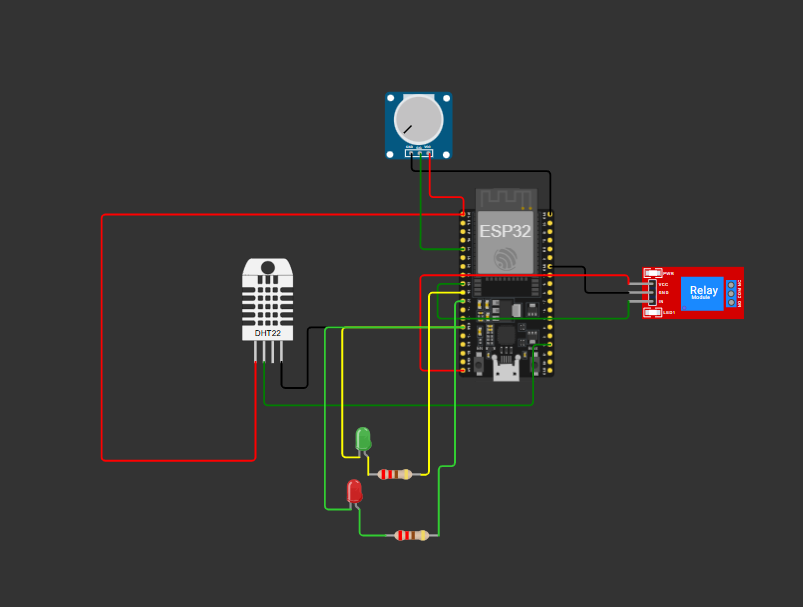
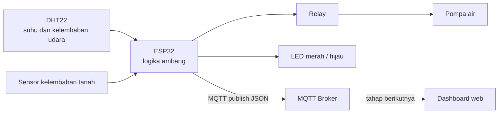

# ArHydroSense

**Sistem Penyiraman Otomatis Berbasis Kelembaban Tanah dengan Monitoring Real-Time Menggunakan ESP32**


ArHydroSense adalah prototipe sistem IoT yang membaca kelembaban tanah, suhu, dan kelembaban udara, lalu menyalakan atau mematikan pompa air secara otomatis berdasarkan ambang kelembaban tanah. Data sensor dikirim secara berkala melalui MQTT dalam format JSON untuk keperluan monitoring real-time.

> **Status proyek:** fase simulasi. Firmware saat ini diuji di [Wokwi](https://wokwi.com/) dan dibangun dengan PlatformIO. Perangkat keras fisik belum dirakit.

**Demo simulasi:** [Buka di Wokwi](https://wokwi.com/projects/479678177083323393) · 



---

## Daftar Isi

- [Fitur](#fitur)
- [Arsitektur Sistem](#arsitektur-sistem)
- [Komponen](#komponen)
- [Konfigurasi Pin](#konfigurasi-pin)
- [Cara Kerja](#cara-kerja)
- [Format Data MQTT](#format-data-mqtt)
- [Struktur Repositori](#struktur-repositori)
- [Menjalankan Simulasi](#menjalankan-simulasi)
- [Menjalankan di Perangkat Fisik](#menjalankan-di-perangkat-fisik)
- [Skenario Pengujian](#skenario-pengujian)
- [Batasan Saat Ini](#batasan-saat-ini)
- [Roadmap](#roadmap)
- [Tim](#tim)

---

## Fitur

- Pembacaan suhu dan kelembaban udara (DHT22) serta kelembaban tanah (sensor soil moisture).
- Kontrol pompa otomatis melalui relay berdasarkan ambang kelembaban tanah.
- Indikator status dengan LED: merah untuk tanah kering, hijau untuk tanah lembap.
- Publikasi data sensor dan status pompa melalui MQTT (JSON) setiap 3 detik.
- Log serial yang terbaca jelas untuk debugging.
- Dapat disimulasikan penuh di Wokwi sebelum perangkat keras dibeli.

## Arsitektur Sistem



Keputusan penyiraman dihitung langsung di ESP32. Broker MQTT hanya dipakai untuk pengiriman data monitoring.

## Komponen

| Komponen | Fungsi |
|---|---|
| ESP32 DevKit | Mikrokontroler utama dan koneksi WiFi |
| DHT22 | Suhu dan kelembaban udara |
| Sensor kelembaban tanah | Pembacaan kelembaban tanah (analog) |
| Modul relay | Saklar untuk pompa |
| Mini pompa air DC | Aktuator penyiraman |
| LED merah dan hijau | Indikator status tanah |

## Konfigurasi Pin

| Fungsi | GPIO ESP32 |
|---|---|
| DHT22 (data) | 15 |
| Sensor kelembaban tanah (analog) | 34 |
| Relay | 25 |
| LED merah | 26 |
| LED hijau | 27 |

GPIO 34 berada pada ADC1, sehingga tetap dapat dibaca saat WiFi aktif.

## Cara Kerja

1. ESP32 terhubung ke WiFi, lalu ke broker MQTT.
2. Setiap 3 detik, ESP32 membaca DHT22 dan sensor kelembaban tanah.
3. Nilai analog tanah (0–4095) dipetakan ke persentase 0–100%.
4. Jika kelembaban tanah **di bawah 40%**, relay aktif (pompa menyala) dan LED merah menyala. Jika tidak, pompa mati dan LED hijau menyala.
5. Data dikirim ke topik MQTT dalam format JSON.

Ambang batas dapat diubah melalui konstanta `BATAS_KELEMBAPAN` di `src/main.cpp`.

## Format Data MQTT

- **Broker:** `broker.emqx.io` (port 1883)
- **Topik:** `wokwi-smartgarden/data`
- **Interval:** 3 detik

```json
{
  "temp": 28.5,
  "humidity": 65.0,
  "soil": 35,
  "pump": "NYALA"
}
```

| Field | Tipe | Keterangan |
|---|---|---|
| `temp` | float | Suhu udara (°C) |
| `humidity` | float | Kelembaban udara (%) |
| `soil` | int | Kelembaban tanah (%) |
| `pump` | string | `NYALA` atau `MATI` |

## Struktur Repositori

```
ArHydroSense/
├── src/
│   └── main.cpp          # Firmware utama
├── docs/
│   └── wokwi-simulation.png
├── diagram.json          # Rangkaian Wokwi
├── wokwi.toml            # Konfigurasi Wokwi untuk PlatformIO
├── platformio.ini        # Konfigurasi PlatformIO
└── README.md
```

## Menjalankan Simulasi

### Prasyarat

- [Visual Studio Code](https://code.visualstudio.com/)
- Ekstensi [PlatformIO IDE](https://platformio.org/install/ide?install=vscode)
- Ekstensi [Wokwi for VS Code](https://docs.wokwi.com/vscode/getting-started) (memerlukan lisensi/akun Wokwi sesuai ketentuan mereka)

### Langkah

1. Clone repositori:
   ```bash
   git clone https://github.com/<username>/ArHydroSense.git
   cd ArHydroSense
   ```
2. Buka folder di VS Code, lalu build firmware:
   ```bash
   pio run
   ```
3. Pastikan `wokwi.toml` menunjuk ke hasil build. Contoh:
   ```toml
   [wokwi]
   version = 1
   firmware = '.pio/build/esp32dev/firmware.bin'
   elf = '.pio/build/esp32dev/firmware.elf'
   ```
   Sesuaikan nama environment jika berbeda dengan `esp32dev`.
4. Jalankan simulasi lewat command palette: **Wokwi: Start Simulator**.
5. Buka serial monitor untuk melihat log, dan ubah nilai sensor kelembaban tanah pada simulasi untuk menguji logika.

Contoh `platformio.ini`:

```ini
[env:esp32dev]
platform = espressif32
board = esp32dev
framework = arduino
monitor_speed = 115200
lib_deps =
    knolleary/PubSubClient
    adafruit/DHT sensor library
```

### Memantau data MQTT

Gunakan klien MQTT apa pun (misalnya MQTTX) dan subscribe ke topik `wokwi-smartgarden/data` pada `broker.emqx.io:1883`.

## Menjalankan di Perangkat Fisik

1. Rakit rangkaian sesuai [konfigurasi pin](#konfigurasi-pin).
2. Ubah `WIFI_SSID` dan `WIFI_PASSWORD` di `src/main.cpp` dengan WiFi milik sendiri.
3. Kalibrasi sensor tanah (lihat [Batasan Saat Ini](#batasan-saat-ini)).
4. Upload firmware:
   ```bash
   pio run --target upload
   pio device monitor
   ```

## Skenario Pengujian

| Skenario | Kelembaban tanah | Hasil yang diharapkan | Output|
|---|---|---|---|
| Tanah kering | di bawah 40% | Relay aktif, LED merah menyala, `pump: "NYALA"` | docs/Nyala.png |
| Tanah lembap | 40% atau lebih | Relay mati, LED hijau menyala, `pump: "MATI"` | docs/Mati.png |
| Data terkirim | semua kondisi | Payload JSON muncul di klien MQTT setiap 3 detik |

## Batasan Saat Ini

Bagian ini mencatat kondisi prototipe apa adanya, agar langkah berikutnya jelas.

- **Kalibrasi sensor tanah belum ada.** Konversi saat ini memetakan 0–4095 langsung ke 0–100%. Sensor kapasitif fisik umumnya memberi nilai ADC lebih tinggi saat kering, sehingga perlu kalibrasi nilai kering dan basah.
- **Polaritas relay.** Kode memakai `HIGH` sebagai tanda pompa menyala. Banyak modul relay bersifat active-low, jadi logikanya perlu disesuaikan dengan modul yang dipakai.
- **Belum ada histeresis.** Satu ambang tunggal dapat membuat relay sering hidup-mati di sekitar nilai 40%.
- **Belum ada batas durasi pompa.** Jika sensor error, pompa dapat menyala terus.
- **Broker MQTT publik tanpa autentikasi.** Topik dan data dapat dibaca atau ditulis siapa saja. Hanya layak untuk simulasi.
- **Kontrol dari jarak jauh belum ada.** Firmware baru mengirim data, belum menerima perintah.

## Roadmap

- [x] Simulasi rangkaian dan logika di Wokwi
- [x] Publikasi data sensor via MQTT
- [ ] Kalibrasi sensor tanah dan penambahan histeresis
- [ ] Batas durasi pompa dan penanganan kegagalan sensor
- [ ] Perakitan perangkat keras fisik
- [ ] Backend penyimpan data dan dashboard web
- [ ] Mode manual/otomatis dari dashboard
- [ ] Autentikasi dan broker privat

## Tim

| Nama | NPM |
|---|---|
| Rahma Hidayati Fitrah | G1A023074 |
| Anis Syarifatul Mursyidah| G1A023036 |
| Herlita | G1A023018 |

Nama **ArHydroSense** diambil dari inisial anggota tim (**A**nis, **R**ahma, **H**erlita) dan *Hydro* + *Sense*.

IoT (Internet Of Things)

